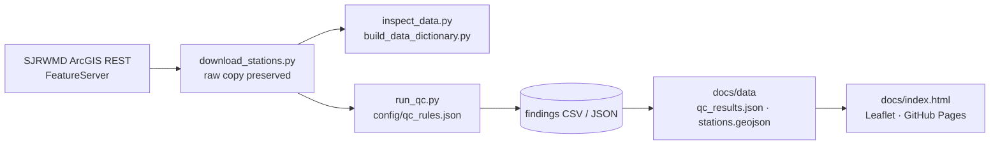

# SJRWMD GeoData Quality Inspector

[](https://scorecard.dev/viewer/?uri=github.com/knightchrism/sjrwmd-geodata-qc)

**Rule-driven QA/QC for public groundwater-station GIS data &mdash; findings you can filter, inspect and export, with the source data left untouched.**

<p>
  <a href="LICENSE"></a>
  
  
  
  
</p>

An independent geospatial QA/QC demonstration using publicly available groundwater monitoring data from the St. Johns River Water Management District (SJRWMD).

**[Launch Interactive Dashboard &rarr;](https://knightchrism.github.io/sjrwmd-geodata-qc/)**

## What it does

- Pulls station records from SJRWMD's public ArcGIS REST Feature Service and preserves the download as-is.
- Applies 8 configurable rules from `config/qc_rules.json` (identifiers, duplicates, geometry presence/validity, optional attributes).
- Writes every finding to CSV/JSON as a reviewable audit trail &mdash; nothing in the source data is changed.
- Ships a static Leaflet dashboard to filter by rule and severity, inspect original values and export findings.

## Architecture


## Project Overview

This project demonstrates an automated workflow for acquiring, inspecting, validating, and visualizing geospatial data using Python and open-source GIS technologies.

The system retrieves groundwater monitoring station records from a public ArcGIS REST Feature Service, applies configurable quality-control rules, and produces an interactive web dashboard for reviewing potential data-quality issues.

## Dataset and Quality Control Results

| Metric | Result |
|---|---:|
| Monitoring stations | 850 |
| QA/QC validation rules | 8 |
| Review findings | 940 |
| Stations flagged | 652 |
| Duplicate station IDs | 0 |
| Missing station geometries | 0 |
| Invalid station geometries | 0 |

### Quality-Control Findings

| Rule | Description | Findings |
|---|---|---:|
| QC001 | Missing station identifiers | 0 |
| QC002 | Duplicate station identifiers | 0 |
| QC003 | Missing geometry | 0 |
| QC004 | Invalid geometry | 0 |
| QC005 | Missing optional UTM attributes | 497 |
| QC006 | Missing well-drilling depth | 348 |
| QC007 | Missing completion date | 94 |
| QC008 | Missing county attribute | 1 |

**Important:** These are independent, project-defined QA/QC review findings—not confirmed errors in SJRWMD's authoritative dataset. For example, records missing UTM attributes can still have valid latitude, longitude, and point geometry.

## Technology Stack

- Python — Data acquisition, processing, automation, and validation
- GeoPandas — Geospatial data analysis
- Pandas — Tabular inspection and quality reports
- Shapely — Geometry validation
- Requests — ArcGIS REST API retrieval
- GeoJSON — Interoperable spatial data format
- JavaScript and Leaflet — Interactive map and investigation dashboard
- GitHub Pages — Static website deployment

## Processing Workflow

1. Retrieve ArcGIS service metadata and monitoring station data.
2. Preserve downloaded source data.
3. Inspect the dataset's structure, attributes, and geometry.
4. Evaluate configurable quality-control rules.
5. Generate detailed CSV and JSON findings.
6. Export spatial data for browser visualization.
7. Investigate findings using the interactive map and station inspector.

The original downloaded source data is not modified by the QA/QC process.

## Project Structure

```text
sjrwmd-geodata-qc/
├── config/
│   └── qc_rules.json
├── data/
│   ├── raw/
│   └── processed/
├── docs/
│   ├── index.html
│   └── data/
│       ├── qc_results.json
│       └── sjrwmd_stations.geojson
├── reports/
├── build_data_dictionary.py
├── download_stations.py
├── export_original_data.py
├── inspect_data.py
├── run_qc.py
├── src_inspect_service.py
├── requirements.txt
└── README.md
```

Some local data and reporting directories are intentionally excluded from version control.

## Installation and Execution

Clone the repository to a local folder such as `C:\dev` (keep projects out of OneDrive-synced folders):

```powershell
cd C:\dev
git clone https://github.com/knightchrism/sjrwmd-geodata-qc.git
cd sjrwmd-geodata-qc
```

Create and activate a Python virtual environment:

```powershell
py -m venv .venv
.\.venv\Scripts\Activate.ps1
python -m pip install -r requirements.txt
```

Retrieve and process the data:

```powershell
python src_inspect_service.py
python download_stations.py
python inspect_data.py
python build_data_dictionary.py
python run_qc.py
```

Start the interactive dashboard locally:

```powershell
cd docs
python -m http.server 8000
```

Then open `http://localhost:8000/`.

## Interactive Dashboard Features

- Geographic display of groundwater monitoring stations
- QC findings symbolized by severity
- Rule-based and severity-based filtering
- Station search
- Interactive map navigation
- Original-value inspection
- CSV export of filtered findings

The published dashboard visualizes previously generated results. Running the Python QA/QC engine and republishing its outputs is necessary to refresh the public dashboard.

## Data Source

St. Johns River Water Management District public ArcGIS REST Feature Service:

[Active Groundwater Monitoring Network — Water Level Event Type](https://services.arcgis.com/s8wtJX9suxFen6TA/ArcGIS/rest/services/Active_Groundwater_Monitoring_Network_Water_Level_Event_Type/FeatureServer/0)

## Disclaimer

**Demo / testing only &mdash; not authoritative.** Findings are not a survey or legal determination and are not confirmed errors in the source data.


This project is an independent technical demonstration and is not affiliated with, endorsed by, or operated by the St. Johns River Water Management District.

The validation rules are illustrative and require review against authoritative data standards and business requirements before operational use.

## Credits

- **Data:** St. Johns River Water Management District, Active Groundwater Monitoring Network public ArcGIS REST Feature Service (link above). Used as published; subject to SJRWMD's terms of use. Basemap &copy; [OpenStreetMap](https://www.openstreetmap.org/copyright) contributors (ODbL).
- **Software:** GeoPandas, Shapely, pandas (BSD-3-Clause), Requests (Apache-2.0), [Leaflet](https://leafletjs.com) (BSD-2-Clause). Each keeps its own license.

## License

Code: MIT, see [LICENSE](LICENSE).

## Future Enhancements

- Configurable spatial boundary checks
- Coordinate-system consistency validation
- Field-level data-quality scoring
- QA/QC historical comparisons
- Analyst review-status management
- Automated processing and deployment through GitHub Actions
